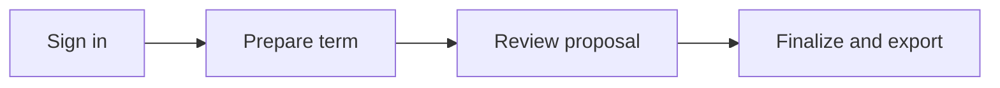

# ParkPermit app flow

## Main workflow

1. **Sign in.** Open the dashboard and choose an existing term or create a new one. Show a generic error if sign-in fails.
2. **Prepare the term.** Upload `applications.csv` and `lots.csv`. Show row counts, data issue counts, warnings, and blocking errors. Enable **Run allocation** once both files pass validation. Replacing files requires confirmation because it clears the existing proposal.
3. **Review the proposal.** Show first-, second-, and third-choice placement rates, unplaced applicants, and open decisions above the lot cards. Each card shows car and bike permit counts, peak occupancy, accessibility, and approval status. Open a lot or the decision list from the dashboard.
4. **Finalize and export.** Approve each lot once its decisions are resolved and any general-capacity override is recorded. After all five lots are approved, confirm **Finalize term**. The term becomes read-only and is ready for CSV export.

## Review actions

| View | What the administrator can do |
| --- | --- |
| **Lot detail** | Compare early, afternoon, and night occupancy for cars and bikes as load, capacity, and percentage. Check accessible bays used and available. Search and filter applicants, read or copy reasons, move an applicant, and approve or unapprove the lot. Mark suggested placements and occupancy states with text. Show historical occupancy with the label “Includes visitors and contractors.” |
| **Decision list** | Filter by lot or flag. Review unmet accessibility needs first, followed by inactive, unplaced, suggested, and over-capacity cases. Accept a suggestion, move or waitlist an applicant, confirm an exclusion, or reinstate an applicant. Record a note for each decision. |
| **Audit** | Filter and export the term’s event history. |

### Move an applicant

1. Select **Move applicant** from Lot detail or Decisions. Show the applicant’s chosen lots first, with walking distances.
2. Preview before-and-after occupancy by shift for both lots within 500 ms. Show a risk warning at 90% or higher and an over-capacity state above 100%. Disable confirmation for blocking rules, including accessible-bay violations. Require an override reason when the move would take general occupancy above 100%.
3. Confirm with a note. Refresh occupancy, reopen approval for the affected lots, and record the move in the audit history. **Undo last move** restores the previous placement and occupancy and records the undo.

[Move validation](ARCHITECTURE.md#54-move-checks-checkspreviewmove) · [Term states](ARCHITECTURE.md#42-mongodb-collections) · [Acceptance criteria](PRD.md#7-epics-user-stories-and-acceptance-criteria)
