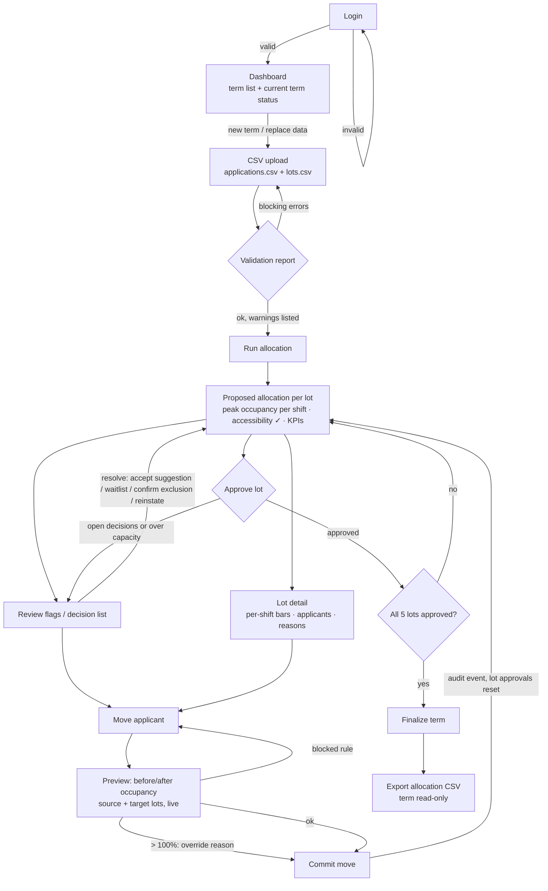
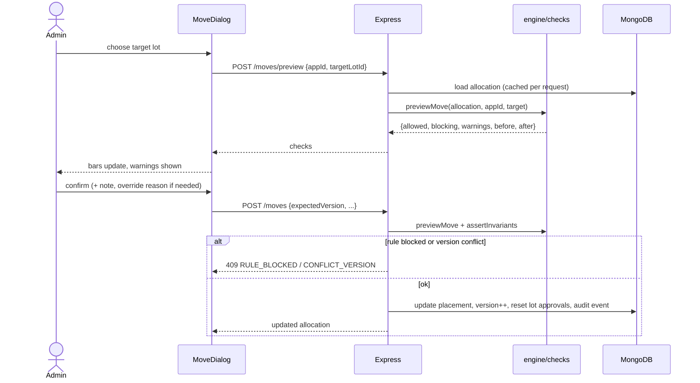
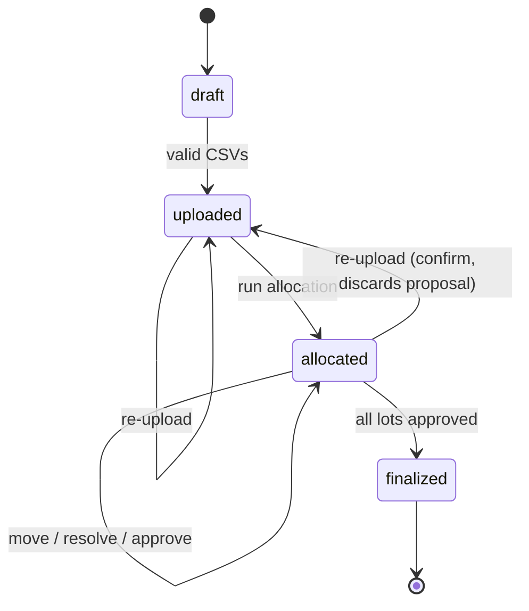

# ParkPermit — App Flow

## 1. Main flow

## 2. Screens
| Screen | Purpose | Key elements | Actions |
|---|---|---|---|
| **Login** | Authenticate admin | Email, password, generic error | Log in |
| **Dashboard** | Term overview | Term status chip; 5 lot cards (permits car/bike, peak %, accessibility ✓/!, approved); KPIs: % in choice 1/2/3, unplaced, open decisions | Upload, Run allocation, open lot, open decisions, Finalize |
| **Upload** | Load the term's data | Two drop zones; schema hint; validation report (errors and warnings per row); data-issue counts (varies, same-lot, inactive, past occupancy note) | Upload, Re-upload, Run allocation |
| **Lot detail** | Inspect one lot | Per-vehicle pool: three shift bars (early/afternoon/night) vs general capacity; accessible bays used/total; `past_peak_count` with "includes visitors & contractors" label; applicant table (id, type, shift, choice rank, status, flags, reason) | Move, Copy reason, Approve / Unapprove |
| **Decision list** | Short list to act on | Sorted: accessibility unmet → inactive → unplaced → suggested → over-capacity; flag filters | Accept suggestion, Move, Waitlist, Confirm exclusion, Reinstate (note required) |
| **Move dialog** | Change a placement safely | Target lot picker (choices first, with distance); live before/after bars for source and target; blocking messages; override reason field when > 100% | Confirm move, Cancel |
| **Audit** | Trace changes | Event table with filters | Export |

## 3. Move: live check sequence

## 4. Term states

