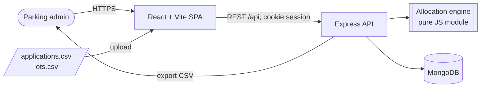
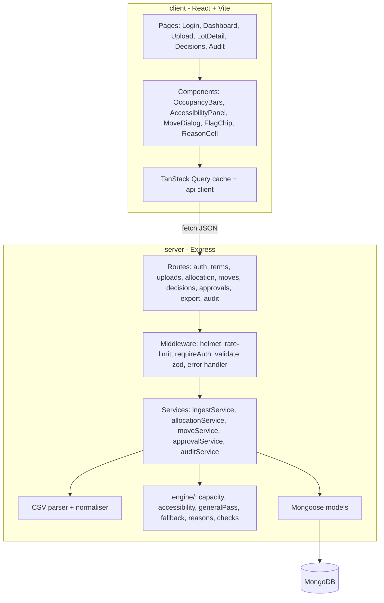
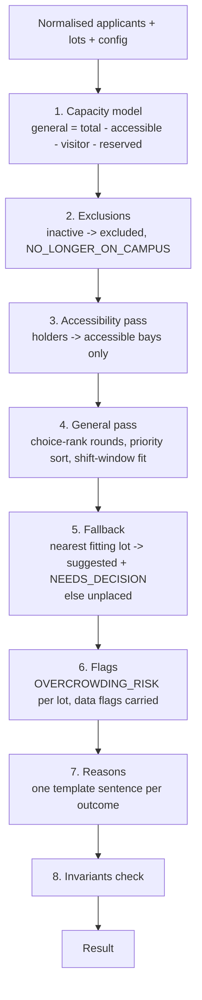
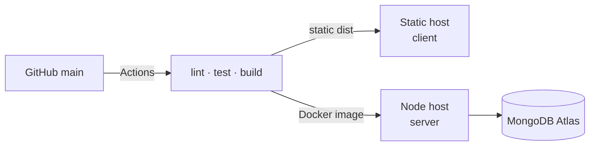

# ParkPermit — Architecture

Stack: **MongoDB, Express, React + Vite, Node.js** (MERN), JavaScript (ES modules) with JSDoc types. Tests use Vitest; API tests use Supertest and mongodb-memory-server.

## 1. Context


## 2. Components


| Component | Responsibility |
|---|---|
| **client** | UI only. No business rules except formatting. Calls `/moves/preview` for live checks. |
| **routes** | HTTP mapping and request validation (zod). Thin. |
| **services** | Orchestrate: load term data, call engine, persist, write audit events. |
| **ingest** | Parse CSV (papaparse), validate schema, normalise known data issues, produce `issues[]`. |
| **engine** | Pure, deterministic functions with no I/O and no Mongo. Input: lots + normalised applicants + config. Output: placements, occupancy, flags, reasons. This is where most unit tests live. |
| **models** | Mongoose schemas and indexes. |

## 3. Key design choices
- **Engine is pure and on the server only.** The client never decides; it asks `POST /moves/preview`, which runs the same `checks` module on a copy of the allocation. There is one source of truth, and preview is fast (one move touches only two lots).
- **Proposal and final state are separate.** `run` creates an `Allocation` with status `proposed`. Moves edit placements in place and write audit events. `finalize` freezes it.
- **Deterministic ordering.** Every sort has a full key ending in `applicantId`. No randomness and no reliance on Mongo or Object key order.
- **Hard rules as invariants.** `checks.assertInvariants(allocation)` runs after every engine run and every move commit: accessible bays ≤ capacity, only holders in accessible bays, inactive applicants not placed. A violation is a 409 and is never saved.
- **Config, not constants.** Shift windows, priority order and the risk threshold live in `server/src/config/allocation.js`, and are copied into each run so results can be reproduced.

## 4. Data model

### 4.1 Input CSVs
`applications.csv`
| Column | Type | Notes |
|---|---|---|
| `id` | string | Unique, e.g. `APP-0001` |
| `name` | string | Display only; never read by the engine |
| `type` | enum | `staff`, `faculty`, `contractor`, `student` |
| `home_block` | enum | `A`–`E` |
| `vehicle` | enum | `car`, `bike` |
| `shift` | enum | `early`, `afternoon`, `night`, `varies` (case-insensitive, trimmed) |
| `pref_1`, `pref_2`, `pref_3` | lot id | `pref_2`/`pref_3` optional |
| `accessibility_permit` | yes/no | No medical details |
| `active_on_campus` | yes/no | |

`lots.csv`
| Column | Type | Notes |
|---|---|---|
| `lot_id`, `name`, `block` | string | e.g. `LOT-A`, "North Lot", `A` |
| `car_total`, `car_accessible`, `car_visitor`, `car_reserved` | int | Defaults 25, 2, 5, 5 |
| `bike_total`, `bike_accessible`, `bike_visitor`, `bike_reserved` | int | Defaults 25, 2, 5, 0 |
| `dist_A` … `dist_E` | int (m) | Walking distance from lot to each block |
| `past_peak_count` | int, optional | Context only; includes visitors and contractors (BR-11) |

### 4.2 MongoDB collections
```mermaid
erDiagram
  USER ||--o{ TERM : creates
  TERM ||--o{ LOT : has
  TERM ||--o{ APPLICANT : has
  TERM ||--o| ALLOCATION : has
  ALLOCATION ||--o{ PLACEMENT : contains
  ALLOCATION ||--o{ LOT_APPROVAL : contains
  TERM ||--o{ AUDIT_EVENT : logs

  USER { ObjectId _id; string email; string passwordHash; string role; date lastLoginAt }
  TERM { ObjectId _id; string name; date startsOn; date endsOn; string status; object uploadSummary }
  LOT { ObjectId _id; ObjectId termId; string lotId; string block; object car; object bike; object distances; int pastPeakCount }
  APPLICANT { ObjectId _id; ObjectId termId; string appId; string name; string type; string homeBlock; string vehicle; string shiftRaw; string[] windows; string[] prefs; bool accessibility; bool active; string[] dataFlags }
  ALLOCATION { ObjectId _id; ObjectId termId; string status; object configSnapshot; date runAt; int version }
  PLACEMENT { string appId; string lotId; string bayType; string status; int choiceRank; string[] flags; string reason; string decisionNote }
  LOT_APPROVAL { string lotId; bool approved; date approvedAt; string overrideReason }
  AUDIT_EVENT { ObjectId _id; ObjectId termId; string action; string appId; object before; object after; string note; date at }
```
- `TERM.status`: `draft` → `uploaded` → `allocated` → `finalized`.
- `PLACEMENT.bayType`: `accessible` | `general` | `none`.
- `PLACEMENT.status`: `placed` | `suggested` | `unplaced` | `excluded` | `waitlisted`.
- Placements and approvals are embedded in `ALLOCATION` (≤ a few thousand rows per term). `version` is incremented on each write for optimistic concurrency (moves send `expectedVersion`).
- Indexes: `applicants {termId, appId}` unique; `lots {termId, lotId}` unique; `auditEvents {termId, at}`.

## 5. Allocation engine

### 5.1 Inputs and outputs
```js
allocate({ lots, applicants, config }) -> {
  placements: Placement[],       // one per applicant
  occupancy: { [lotId]: { car: Pool, bike: Pool } },
  summary: { choiceRate: {1,2,3}, unplaced, decisions, accessibilityOk }
}
// Pool = { generalCap, accessibleCap, load: { early, afternoon, night }, accessibleUsed, peakPct }
```

### 5.2 Pipeline


### 5.3 Rules in detail
1. **Capacity.** For each lot and vehicle: `generalCap = total − accessible − visitor − reserved`, `accessibleCap = accessible`. Load is tracked per window `{early, afternoon, night}`.
2. **Exclusions.** `active = false` → `excluded`, never placed (BR-6).
3. **Accessibility pass.** Holders (active) are sorted by `typeRank, appId`. Each tries `prefs` in order, then other lots by `dist[homeBlock]`, and takes the first lot with `accessibleUsed < accessibleCap` for their vehicle. If none is free → `unplaced` + `NEEDS_DECISION` (top of the decision list). Holders never enter the general pass.
4. **General pass.** For `rank = 1..3`, for each lot, the candidates whose `prefs[rank-1]` is this lot and who are still unplaced are sorted by `(typeRank, lot.dist[homeBlock], appId)`. Each is placed if `fits(lot, vehicle, windows)`:
   ```js
   fits = windows.every(w => load[w] + 1 <= generalCap)
   ```
   `varies` → windows = all three. Night applicants use only the `night` window, so they share bays with early and afternoon holders (UAT-3).
   Running rank 1 for all lots before rank 2 means a person's first choice always beats someone else's second choice for the same lot.
5. **Fallback.** Remaining applicants try all lots not in their prefs, ordered by `dist[homeBlock]`. The first that fits → `suggested` + `NEEDS_DECISION`. Otherwise `unplaced` + `NEEDS_DECISION`.
6. **Flags.** `OVERCROWDING_RISK` on a lot pool when `max(load)/generalCap ≥ config.riskThreshold` (0.9). Data flags (`HOURS_VARIES`, `SAME_LOT_ALL_CHOICES`, `NO_LONGER_ON_CAMPUS`) come from ingest.
7. **Peak occupancy** per pool = `max(load.early, load.afternoon, load.night) / generalCap`. Shown per window as well.

Complexity is O(n log n + n·L) for n applicants and L lots, which is trivial at campus scale.

### 5.4 Move checks (`checks.previewMove`)
Input: allocation, `appId`, `targetLotId`, optional `bayType`. Output: `{ allowed, blocking[], warnings[], before, after }` for the source and target pools.
- **Blocking (cannot override):** a non-holder into an accessible bay; accessible bays over capacity; placing an excluded applicant without reinstating them first.
- **Needs override reason:** any target window > 100% of general capacity.
- **Warnings:** target ≥ 90%; target not in the applicant's choices.
Commit (`POST /moves`) reruns the checks server-side and then the invariants, bumps `version`, writes an audit event, regenerates the reason ("Moved by administrator: <note>"), and clears approval of both affected lots.

### 5.5 Reason templates
| Outcome | Template |
|---|---|
| Placed, choice n | "Placed in {lot}, your choice {n}, as space was available for {shift} hours." |
| Placed, shared | "Placed in {lot}, your choice {n}; your {shift} hours share a bay with a different shift." |
| Not in earlier choice | "{lot of choice k} was full for {shift} hours after higher-priority groups and closer applicants were placed." |
| Accessible | "Placed in an accessible bay at {lot} under campus accessibility policy." |
| Suggested | "None of your chosen lots had space for {shift} hours; {lot} is the nearest lot with space, pending administrator review." |
| Unplaced | "No lot had space for {shift} hours; your application is held for an administrator decision." |
| Excluded | "Not allocated because records show you are no longer on campus; contact parking services if this is wrong." |
| Varies | appended: "Hours listed as 'varies' were treated as full day." |
| Same lot | appended: "You listed {lot} for every choice." |
| Admin move | "Placed in {lot} by the parking administrator: {note}." |

Reasons mention only the applicant's own lot, choice rank, priority group and shift. They never mention other people or the accessibility status of others.

## 6. API (all under `/api`, JSON, cookie auth except login)
| Method | Path | Purpose |
|---|---|---|
| POST | `/auth/login`, `/auth/logout`; GET `/auth/me` | Session |
| POST / GET | `/terms`, `/terms/:termId` | Create or read a term |
| POST | `/terms/:termId/upload` | multipart `applications`, `lots` → validation report |
| POST | `/terms/:termId/allocation/run` | Run the engine → proposal |
| GET | `/terms/:termId/allocation` | Summary + lots + placements (filters: `lot`, `flag`, `status`) |
| GET | `/terms/:termId/lots/:lotId` | Lot detail with per-window occupancy |
| POST | `/terms/:termId/moves/preview` | Live checks, no write |
| POST | `/terms/:termId/moves` | Commit a move (`expectedVersion`, `overrideReason?`, `note`) |
| POST | `/terms/:termId/moves/undo` | Undo the last move |
| GET / POST | `/terms/:termId/decisions`, `/decisions/:appId/resolve` | Decision list and resolve |
| POST | `/terms/:termId/lots/:lotId/approve` and `/unapprove` | Lot approval |
| POST | `/terms/:termId/finalize` | Freeze the term |
| GET | `/terms/:termId/export.csv` | Allocation export |
| GET | `/terms/:termId/audit` | Audit events |

Errors use `{ error: { code, message, details? } }`. Codes are `VALIDATION`, `UNAUTHORIZED`, `CONFLICT_VERSION`, `RULE_BLOCKED`, `NOT_FOUND`.

## 7. Security and privacy
- Single admin seeded from env (`ADMIN_EMAIL`, `ADMIN_PASSWORD_HASH`). bcrypt. JWT in an httpOnly, SameSite=strict cookie, 8 h expiry.
- helmet, CORS limited to the client origin, express-rate-limit on login, upload size limit 2 MB, zod validation on every body.
- Accessibility flag: stored as a boolean only, used by the accessibility pass and the panel. It is excluded from export unless needed (export shows `bayType=accessible` only).
- Synthetic data only. `data/` contains only generated files, and `.gitignore` blocks `*.real.csv`.

## 8. Deployment

Hosting targets (for example Vercel or Netlify for the client and Render or Fly for the server) are placeholders. See [CICD.md](CICD.md).
